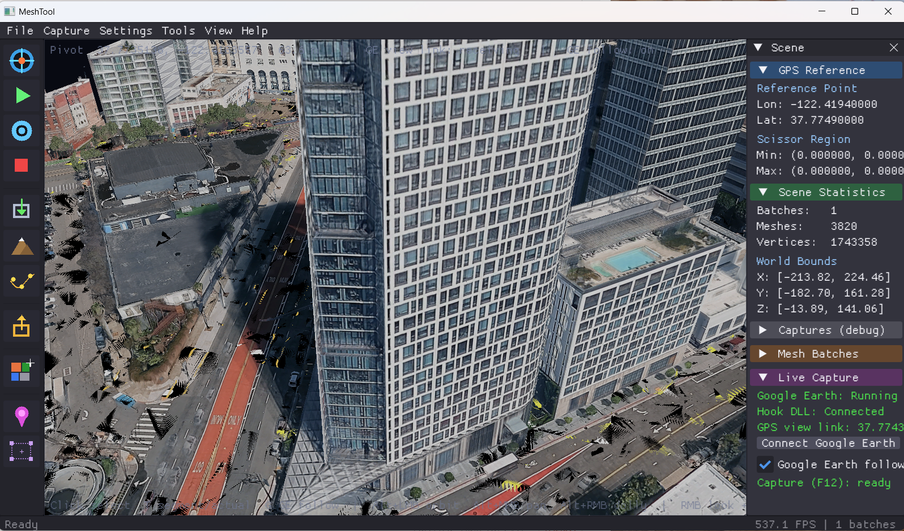
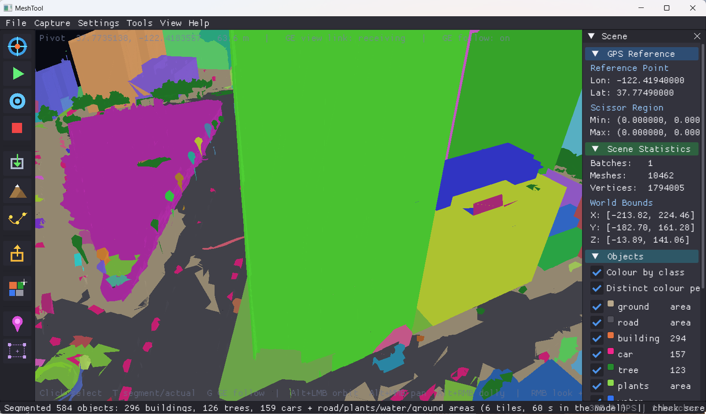

# MeshTool

Captures Google Earth Pro's 3D meshes live, places them at their real GPS
position, stitches overlapping captures into one scene, splits it into objects
(buildings, trees, cars, road, ...) and exports glTF / Maya.

- **Live capture** through a GL hook (`opengl32.dll` proxy / injectable
  `meshtool_hook.dll`), georeferenced through a KML link with Google Earth
- **Stitching** of any number of captures: exact placement from shared tiles,
  duplicate and level-of-detail cleanup, any zoom or camera angle
- **Google Earth follows the viewport**: move in MeshTool, Google Earth flies along
- **AI segmentation** into objects with a local vision model (Ollama)
- **Building refinement**: segmented buildings become clean models (straight
  walls on the captured facades, planar roofs) with glass curtain walls
- **Export** to glTF 2.0 (`.glb` / `.gltf`) and Maya ASCII

Built with GLFW + Dear ImGui + Vulkan (the old Qt6/OpenGL UI was replaced).



*A live capture of downtown San Francisco. The Live Capture panel shows the
GPS link to Google Earth, viewport follow on, and capture ready.*



*The same scene after Tools > Segment Scene: 296 buildings, 126 trees and 159
cars as separate objects (here a distinct colour per building), plus road,
plants, water and ground areas.*

## Guide

A typical session, from an empty scene to an exported model:

1. **One-time setup.** Build (see below), then run `deploy_hook.bat` as
   administrator and pick option 2. This puts the capture hook
   (`opengl32.dll`) next to Google Earth Pro. Redeploy after pulling hook
   changes, with Google Earth closed.
2. **Start.** `run.bat` starts MeshTool with an empty scene. To continue
   earlier work, File > Open Scene (Ctrl+O).
3. **Open Google Earth.** Capture > Navigate & Capture (Ctrl+N) flies Google
   Earth to an address or GPS coordinate. Capture > Launch Google Earth just
   opens it. A Google Earth you started yourself: Live Capture panel >
   **Connect Google Earth**.
4. **Check GPS.** Move Google Earth once and let it stop. The Live Capture
   panel shows *GPS view link: lat, lon* with your location. Captures taken
   before that have no GPS and are set aside from the rest.
5. **Capture.** Frame the area in Google Earth and press **F12** there (or
   F5 / Capture > Capture Frame in MeshTool). Move on to a neighbouring or
   overlapping spot and capture again: captures stitch into one scene, at any
   zoom or camera angle. A capture keeps only the tiles at its finest level
   of detail: Google Earth also draws coarser parent tiles under them and
   towards the horizon, and those are skipped (Live Capture panel > *Finest
   tiles only*; off, coarse tiles are kept wherever no finer tile covers
   them).
6. **Drive from MeshTool (optional).** Press **G**: Google Earth now flies to
   wherever you leave the MeshTool viewport camera. Its overlay shows
   *F12: WAIT - SETTLING* while it flies and loads, then *F12: CAPTURE READY*.
   Press F12 then.
6b. **Route capture (optional).** Capture > Route Capture... takes two
   addresses (or "lat, lon"), looks them up with OpenStreetMap Nominatim,
   asks the OSRM demo server for the driving route, and places a camera every
   100 m along it (height 100 m above ground, bird's-eye view straight down,
   turned along the route; tilt adjustable). Google Earth is started if needed, flown to each
   camera through the follow link, and a frame is captured once the view has
   settled and the tiles have loaded. "Also capture looking back" adds a
   turned-around capture at every stop. Progress shows in the Live Capture
   panel, where Stop ends the run; captures stitch into one scene as usual.
   `MeshTool --route "from" "to" [--spacing m] [--look-back]` prints the
   cameras without Google Earth. Needs an internet connection.
   View > Top-down orthographic (O) reviews the result like an orthophoto:
   a parallel projection straight down, north up, without perspective lean.
   `--shots ... --ortho` saves check screenshots that way, and a route
   capture started from the command line ends with them. The route is kept
   with the scene (File > Save Scene) for the drive simulation below.
6c. **Drive simulation (optional).** Tools > Drive Simulation (toolbar Sim)
   drives a car along the scene's saved route at a set speed (40 mph by
   default), with a chase, driver's-seat, follow or free camera; Space
   pauses. The road is recovered from the mesh along the route: the captured
   surface is sampled across the road width every 0.1 m along it. Trees
   overhanging a road put the photogrammetry surface at the canopy top, which
   is bumpy and metres above the road, while the road itself (bridge decks
   included) is flat and continuous: the flat stretches are chained together
   from the longest one outward, a stretch that steps up by more than *Tree
   height* (2.5 m) is dropped as canopy (one that steps down is water or a
   hole), short gaps are bridged straight, a rejected stretch follows the
   captured surface wherever it stays near the profile (iterated, so the
   profile climbs hills through holes in the canopy), a long stretch of solid
   canopy follows the canopy floor lowered by the tree height seen where the
   road enters and leaves it, and the result is smoothed. The profile only
   guides the car (nothing is drawn for the road). While driving, the car's
   height is checked every 10 m (*Check every*): where the road is in view
   from above the car stays on the profile; where trees cover it the road
   height is guessed as the local tree tops minus the tree height, measured
   nearby where the road is exposed with trees beside it (the median rise of
   the surface beside the road over the road, within 100 m), held within a
   road-like grade (12%) of the exposed road on either side, and the car
   eases to that height (the viewport readout shows the correction;
   `--no-height-check` turns it off for `--shots --sim`, and `--road-csv
   file` writes the recovered road with the check's result). A sky dome
   surrounds the view. The mesh over the road corridor (*Clear width*, 20 m) higher than
   *Clear above road* (1.5 m) can be cut out of the view while the simulation
   runs, so the car stays visible under trees; the corridor's uncovered black faces are also hidden (Stop puts it back; the saved
   scene is not changed). *Record video...* saves the drive as an H.264 MP4
   (30 fps, Windows Media Foundation, no extra software): the simulation then
   advances one frame of simulated time per video frame, and the recording
   ends when the car arrives or on *Stop recording*. A scene saved without a
   route takes two addresses in the dialog and looks the route up.
   `MeshTool scene.mtscene --sim-video drive.mp4 [--sim 0.3] [--sim-seconds 60]`
   records a drive from the command line. `MeshTool scene.mtscene --shots prefix --sim [0..1]` screenshots
   the car parked part way along the route.
7. **Inspect.** Scene panel > Captures (debug) colours tiles by capture and
   draws the camera path; click any mesh for its details (T toggles
   highlighted / as captured). Delete (or the context menu's Delete
   selected) removes the selected mesh, or every mesh of the selected
   object, from the scene; the file changes only when you save. Opening a
   scene drops meshes that are exact copies of another (same vertices,
   triangles and place), which captures can leave behind.
8. **Segment.** Tools > Segment Scene (AI) splits the scene into buildings,
   trees, cars, road, plants, water (needs Ollama for best results; see
   below).
9. **Save and export.** File > Save Scene (Ctrl+S) embeds segmentation with the
   scene: object names/classes, building identities and mesh assignments are
   restored by Open Scene without running segmentation again. If segmentation
   or refinement is still running, saving waits for the result. Unrefined
   segmented scenes reopen in class colours; refined scenes show their materials.
   File > Save Scene (Ctrl+S) keeps everything in
   `.mtscene`; File > Export Mesh writes `.glb` / `.gltf` / `.ma`.

**If something looks wrong**

| Symptom | Check |
|---|---|
| GPS view link shows None or 0, 0 | Google Earth lacks MeshTool's links: Connect Google Earth, or restart it from MeshTool. Remove old "MeshTool ..." entries under Temporary Places. |
| A capture lands beside the scene, not in it | It had no GPS and shared no tiles with the scene (see the capture log's `placement` lines). |
| Overlay stays on *WAIT - SETTLING* | `[gate]` lines in the capture log show which condition holds it. |
| Flicker or holes where captures overlap | Capture log `LOD filter` lines; Captures (debug) shows which capture each tile came from. |
| Captures arrive by themselves | Navigate & Capture > *Auto-capture after load* is on. |

Logs: `C:\Users\Public\meshtool_capture.log` (MeshTool side) and
`C:\Users\Public\meshtool_proxy.log` (inside Google Earth).

## Requirements

- Windows 10+, Visual Studio 2022 (x64), CMake >= 3.16, git
- Vulkan SDK (provides `glslc` for shader compilation)
- For Tools > Refine Buildings: Python 3.10+ with CUDA PyTorch and
  `pip install -r tools/building_refine/requirements.txt`; the SAM2
  (`facebook/sam2.1-hiera-small`) and CLIP (`openai/clip-vit-large-patch14`)
  weights download from Hugging Face on first use

## Setup

Run `setup.bat` once. It downloads every dependency into `thirdparty/`
(gitignored) - nothing outside the repo is used. Re-running it skips anything
already present; delete a `thirdparty/<lib>` folder to re-download that one.

| Library | Version | How |
|---|---|---|
| GLFW | 3.4 | git |
| Dear ImGui | 1.90.9 | git |
| nativefiledialog | release_116 | git |
| cpp-httplib | 0.15.3 | git |
| zlib (+ minizip) | 1.3.1 | git |
| expat | 2.6.2 | git |
| uriparser | 0.7.5 | git |
| GeographicLib | 2.3 | git |
| libkml | master | git |
| Boost headers (smart_ptr and deps only) | 1.84.0 | git |
| glm | 1.0.1 | git |
| stb (stb_image, stb_image_write) | master | git |

## Build

```
cmake -S . -B build -G "Visual Studio 17 2022" -A x64
cmake --build build --config Release
```

The source libraries are built as static libs by `cmake/ThirdParty.cmake`.
glm and stb are header-only. The compiled shaders are copied next to `MeshTool.exe`.

## Run

`run.bat` - starts `build\Release\MeshTool.exe` from the repo root, where
`land_ocean_ice_8192.png` and `mesh_tool.cfg` live.

After pulling hook changes, redeploy the proxy (`deploy_hook.bat` as
administrator, option 2): MeshTool and `opengl32.dll` share the capture buffer
layout (16 GB, 64-bit offsets) and must match - an older hook shows "not connected".

## Procedural tree replacement

Segment the scene first (Tools > Segment Scene), then choose **Tools > Replace
Trees (Procedural)**. Replace all segmented trees, or select a tree and use
**Replace selected tree** in its panel or right-click menu. The default fits a
simple crown profile to the captured tree; Round and Conifer are optional shapes.
Each replacement matches the captured crown's position, width, depth and top.
With **Use nearby ground for trunk base**, nearby terrain triangles or ground
samples establish the trunk base; without usable ground evidence, the captured
tree's lower bound is used. Ground inferred this way is an estimate.

Original geometry and textures stay embedded in the scene. Select a replaced
tree and switch **Original / Refined**, or use **All originals / All refined**
in the Objects panel. Save the scene to keep both versions. Replacing again
starts from the archived capture and replaces the previous procedural tree.
Buildings, roads, other objects and geographic references are retained.

This is a rough shape match with a trunk and low-poly crown, not a species or
leaf reconstruction. One tree is generated per segmented tree object; merged
crowns need to be separated during segmentation. Uses Python and NumPy, with
no AI models or downloads. A placement report is saved beside the output scene.

```powershell
python tools/building_refine/trees.py input.mtscene output.mtscene --shape fitted
# Selected tree only:
python tools/building_refine/trees.py input.mtscene output.mtscene --target 0:0:12
# Native worker entry point:
build\Release\MeshTool.exe --refine input.mtscene output.mtscene --trees
```

## Zone capture

Click the rectangle-and-dots toolbar icon beside Route Capture, or choose
Capture > Zone Capture. With a georeferenced scene open, click **Draw rectangle
in viewport**: the view switches to north-up orthographic. Drag the capture
rectangle with the left mouse button (Esc cancels), then review the sample grid.
For an empty scene, use **Center on Google Earth** or enter the latitude and
longitude of two opposite corners.

Set maximum sample spacing, camera height above ground, view overlap (60% by
default), and the load wait, then click **Start zone capture**. The grid spacing
is limited using the smaller of Google Earth's horizontal and vertical fields
of view, the camera height, and the requested overlap. If the field of view is
unavailable, conservative defaults are used. Choose a height above the tallest
building; the default is 300 m. Low cameras can clip towers and obscure ground.
Google Earth visits the grid in alternating rows, waits for each view to settle,
and captures straight down. The existing stitching pipeline merges overlapping
captures into the scene. Zone capture retains coarser ground tiles wherever
finer geometry is missing, overriding **Finest tiles only** for the run. Otherwise
Google Earth's finer building tiles can leave holes where the coarser streets
were discarded. A sample that cannot settle stops the run as incomplete rather
than silently leaving a gap. Save the result with File > Save Scene. The rectangle
controls camera samples; captured tiles can extend outside its boundary.

Progress and Stop are in the Live Capture panel and Zone Capture dialog. Zone
and route capture share one queue, so only one runs at a time. Zone samples do
not replace a saved driving route. Plans are limited to 10,000 samples; polar
zones (85 degrees and above) and date-line crossings are not supported.

## Live capture

MeshTool starts with an empty scene; open a saved scene (Ctrl+O) or capture.
Launch Google Earth from MeshTool (Capture > Launch Google Earth, or Navigate &
Capture), then Capture Frame or F12 inside Google Earth.

- **GPS.** MeshTool loads a KML into Google Earth with two NetworkLinks to its
  local server (`http://127.0.0.1:47321`): `/view` reports Google Earth's view
  when its camera comes to rest, `/follow` is polled for viewport follow. For a
  Google Earth started some other way, Live Capture > **Connect Google Earth**
  loads the links into it. The Live Capture panel shows the last GPS view
  received and its age - capture only once it shows your location. Captures
  are placed in East/North/Up metres at a GPS origin (the first capture's
  look-at point); heights are GE's (above sea level).
- **Merging.** Each capture is matched against every captured area. Tiles
  both contain give the exact camera-to-camera transform (checked per tile in
  the log), whatever the zoom or tilt; without shared tiles, GPS places it if
  it borders an area at a comparable level of detail. Any other capture starts
  a new area beside the others - nothing is replaced. An area captured without
  GPS has no true location and is set to the east of the rest. Overview
  captures (Google Earth zoomed far out, finest tile over 1 km) are dropped by
  the next capture.
- **Duplicates and levels of detail.** Tiles already captured are dropped; a
  quadtree tile captured twice with different data keeps the older copy. Google
  Earth draws coarse tiles under finer ones: coarse triangles that finer tiles
  cover completely are removed, and the rest are drawn slightly behind the finer
  ones (pushed back along the view rays, so their pixels stay put) instead of
  z-fighting them.
- **Google Earth follows the viewport** (G, or the Live Capture checkbox):
  whenever the viewport camera comes to rest, Google Earth flies to the same
  position and direction. Needs a GPS-referenced scene. While following, new
  captures don't reframe the viewport.
- **Capture debug view** (Scene panel > Captures (debug)): colours tiles by the
  capture that produced them and draws each capture's camera, view direction,
  footprint and the path between captures; lists each area's captures with
  placement method and tile counts. Clicking a tile shows its capture.
- **Diagnostics:** `C:\Users\Public\meshtool_capture.log` (placement, shared-tile
  residuals, GPS checks, LOD filter, area moves) and
  `C:\Users\Public\meshtool_proxy.log` (hook side).

## Segmentation

Tools > Segment Scene splits the scene into objects: each building, tree and
car on its own (`building_012`, `tree_007`, `car_003`), plus one object each
for road, plants, water and other ground. Needs [Ollama](https://ollama.com)
with a vision model (default `qwen3.8:latest`); without it, classes come from
colour and height only.

1. The mesh is rendered top-down (0.25 m/pixel): colour, height, coverage.
2. A ground model (lowest points flooded across max-35% slopes, local plane
   fits) gives height above ground - exact on slopes and hills.
3. Raised areas split into instances at height breaks (1.5 m, or 8% of the
   height for towers, so terraced crowns stay whole); steep facade pixels join
   the highest roof they hang from. Tiers / towers / rooftop structures that
   stand on a lower part holding most of their outline are merged into it, and
   so are pieces too slender to stand alone (facade ledges and fins: footprint
   under 3% of height squared) into the taller part they touch. Ground split
   into colour regions.
4. The model labels numbered regions on 768 px tiles, told which are raised;
   answers are schema-constrained JSON.
5. Triangles seen from above join the object under them; walls inherit
   their roof's object along the mesh, flowing only downward (so ground never
   climbs a wall); walls in tiles not stitched to their roof look behind
   themselves (against the normal) for a roof that reaches their top; stray
   triangles take the object of their mesh neighbours,
   and meshes are split per object. Objects are saved in `.mtscene` and name the
   glTF nodes.

When segmentation finishes, the 3D viewport is saved twice for checking -
class colours and original textures - as
`screenshots\check_<time>_segment.png` / `_original.png` in the MeshTool folder.
Tools > Save Check Screenshots takes the pair again from the current view.
Each run also saves its input as `last_input.mtscene` in the debug folder, so it
can be re-run and checked offline:

```
MeshTool --segment last_input.mtscene out.mtscene [--no-model] [--debug-dir d] [--dump]
MeshTool out.mtscene --shots prefix [--frame building_012] [--yaw 30] [--pitch -20] [--zoom 0.85]
```

`--dump` adds raw rasters (`top.f32`, `object.i32`), `objects.txt` and per-triangle
labels (`tris.bin`) to the debug folder; `--shots` opens a scene, aims at an
object, saves the check-screenshot pair and exits.

Scene panel > Objects: colour by class, show/hide classes. Debug images
(orthophoto, regions, classes, marked tiles) and a log go to
`C:\Users\Public\meshtool_segment\`. Headless:
`MeshTool.exe --segment in.mtscene out.mtscene [--no-model] [--res m]`.

## Refine Buildings

Tools > Refine Buildings (needs a segmented scene) replaces each building with a
clean model and loads the result in place of the current scene (save it with
File > Save Scene). The work is done by `toolsuilding_refine
efine.py`, run
with `python` from PATH (or `MESHTOOL_PYTHON`) on a copy of the scene.

1. **Outline**: the building's top-down mask, sharpened by SAM2 on the orthophoto.
2. **Roof**: split into planes (RANSAC + region growing); planes flatter than 4°
   become level.
3. **Walls**: for each roof part, a horizontal slice through the captured mesh
   just below that roof gives where the facade really stands (not the roof edge,
   which parapets, canopies and overhangs push off it); edges near the
   building's main directions are straightened onto them.
4. **Textures**: each new face is textured by projecting the original mesh onto
   it (8 cm per texel), so the model keeps the captured look.
5. **Glass**: CLIP classifies 3 m facade cells; curtain walls get the glass
   material (darker texels are panes: translucent over a dark interior, sky
   reflection with Fresnel; the frame stays opaque). Scene panel > Objects >
   Glass facades sets opacity and reflection.

A building is replaced only if its walls lie on the captured facades (at least
65% of the street-facing wall area within 1.5 m); buildings at the edge of the
capture, small ones and poor fits keep their captured mesh. Facade slivers the
segmenter split off are absorbed into the refined building next to them.
Progress and the log (`refine.log`) go to the segmentation debug folder.

**Clean scene** (checkbox / `--clean`) goes further: cars (including buses and
vans the segmenter made into a small building or tree) and surface clutter
(people, poles, bins, parked-car rows left in a ground class: raised blobs under
60 m²) are removed, and ground,
roads, plants and water are rebuilt as one textured height field from the
top-down raster - holes under trees, cars, clutter and buildings are filled from
their surroundings - heights geometrically, the orthophoto with LaMa image
inpainting, so lane markings, kerbs and paving continue across the filled area
(`--no-lama` for a plain geometric fill; the 200 MB `big-lama.pt` downloads once
into `~/.cache/meshtool`) - with refined walls set down onto it.
Trees keep their captured meshes. The result is one terrain mesh per class
(0.5 m grid, `--terrain-step`) on 2048 px orthophoto pages.

**Remove hidden surfaces** (checkbox / `--cull`, always on with clean) deletes
triangles no view from above the horizon sees: ~60 orthographic views
rasterize triangle ids; coincident surfaces (the z-fighting) are settled by
priority - refined models and terrain over captured, textured over Google
Earth's dark overlay tiles, earlier over later - so one of two coincident
triangles survives. Trees never occlude (what is under them stays for when
trees are hidden). Undersides seen only from below are lost.

Google Earth's captures carry placeholder textures: a near-black overlay pass
drawn over the ground tiles at the same depth, and a yellow/black checker on
tiles whose imagery had not streamed in. refine.py draws triangles with such
textures last (they lose every depth tie to their textured twins), never bakes
or textures from them, fills their colour from the surrounding surface, and
with Clean scene drops the ones lying on the rebuilt terrain.

```
MeshTool --refine in.mtscene out.mtscene [--no-glass] [--clean] [--cull]
python toolsuilding_refine
efine.py in.mtscene out.mtscene [--only building_012,...] [--no-sam] [--no-glass] [--clean] [--cull] [--no-lama] [--debug-dir d]
MeshTool --objects in.mtscene [out.mtscene] [--remove car]
MeshTool --route "Ferry Building, San Francisco" "Union Square, San Francisco" [--spacing 100] [--look-back]
MeshTool --capture-route "from" "to" [--spacing m] [--height m] [--tilt deg] [--dwell s] [--look-back] [--save out.mtscene]
MeshTool scene.mtscene --shots prefix --box x0 y0 z0 x1 y1 z1 [--no-glass] [--yaw ..] [--pitch ..] [--zoom ..] [--ortho] [--sim [fraction]]
MeshTool scene.mtscene --sim-video drive.mp4 [--sim fraction] [--sim-seconds n]
```

`--objects` lists a segmented scene's objects (name, class, size, centre) and
can drop a class; `--box` frames a fixed world box, so shots of two scenes line
up for before/after comparison.

## Scene files

File > Save Scene / Open Scene (Ctrl+S / Ctrl+O): `.mtscene`, MeshTool's
lossless native format - meshes, textures as captured, GPS origin, segmented
objects, (version 4) each mesh's material (captured, glass, interior) and
(version 6) the driving route the scene was captured along, which the drive
simulation uses.

## Viewport

| | Maya style | Unreal style |
|---|---|---|
| Orbit / look | Alt + LMB | RMB drag (look around) |
| Pan | Alt + MMB | MMB, or LMB + RMB |
| Dolly / move | Alt + RMB | LMB drag (forward/back + turn) |
| Fly | | RMB + W/A/S/D, Q/E down/up; wheel = speed, Shift = faster |

Wheel zooms to the pivot, F frames everything.

Click a mesh to select it (Scene panel > Selected Object: class, size, GPS,
capture; Isolate / Frame / Clear); T switches the selection between highlighted
and as captured. G toggles Google Earth following the viewport. Space pauses
and resumes a running drive simulation.

## Export

File > Export Mesh writes glTF 2.0, picked by the extension you type:

- `.glb` - one self-contained file, textures embedded
- `.gltf` - JSON + `<name>.bin`, textures in `<name>/textures/`
- `.ma` - Maya ASCII

Meshes keep their world-space offset as node translations (source data is
Z-up; a root node rotates it to glTF's Y-up). Materials use
`KHR_materials_unlit`, since the captured textures already have lighting baked in.

## Separate terrain scene

Export a segmented capture into a new directory before adding procedural assets:

```powershell
python tools/building_refine/terrain_scene.py capture.mtscene scenes/terrain_output --resolution 0.5 --step 2
```

This creates `terrain.mtscene` with only ground, roads, low vegetation and water
where those classes are captured. Original world coordinates and geographic
references are preserved. The input and existing output directories are never
overwritten. Archived original meshes take precedence over PCG variants.

Tree crowns, buildings and cars are excluded from elevation samples. Broad
mislabelled roofs/crowns are filtered; hidden ground is interpolated from nearby
ground, not lowered by an assumed tree height. The export includes float height,
coverage, inferred-ground and tree-cover maps in NPZ; a 16-bit PNG heightmap with
world-height decoding in `manifest.json`; and the distance to measured ground.
Ground under dense forest is an estimate when no underlying surface was captured.

The manifest records source IDs, world bounds, anchors and terrain elevations for
later placement of PCG buildings and instanced trees. Those assets are not added
to the terrain scene by this step. Filled ground textures still contain baked
lighting/shadows from the capture and are not newly observed imagery.

### Add saved PCG buildings to terrain

Use a full-scene PCG library that retains the original object indices and archived capture meshes:

```powershell
python tools/building_refine/compose_terrain.py scenes/terrain_ground_20261016/manifest.json scenes/pcg_rows_20261010/full_scene_rows.mtscene scenes/terrain_pcg_new
```

This creates `terrain_pcg.mtscene` and a placement manifest in a new directory. Only refined building variants are added; buildings without PCG models are recorded as pending. The compositor verifies archived geometry, source textures and geographic references against the terrain's original capture. World coordinates, terrain and source files are preserved. It does not move buildings onto uncertain interpolated ground or include captured building fallbacks, trees or cars.

### Reconstruct roads and street signals

```powershell
python tools/building_refine/road_scene.py scenes/terrain_pcg_fixed_v2_20261016/terrain_pcg.mtscene scenes/terrain_fixed_v2_20261016/manifest.json scenes/roads_new
```

Creates a separate `roads_pcg.mtscene`, preserving the existing terrain and PCG buildings. Road segmentation supplies the asphalt footprint. Existing terrain triangles are partitioned into road and remaining ground, with identical vertices along the seam and no overlapping surface. White, yellow and red paint strokes are filtered from the captured surface, straightened and baked into the road atlas. Related red paint fragments are fitted as continuous constant-width lanes across small occlusions, with alignment and road-support checks preventing merges across parallel lanes or real road breaks. Small segmentation gaps are repaired before road partitioning; existing PCG building footprints remain excluded. Skeleton pruning and surrounding road approaches identify candidate junctions for static traffic-light assemblies. Signal poles are placed outside the reconstructed carriageway and avoid segmented buildings. The manifest records input hashes, junctions and signal positions.

This is a visual reconstruction: paint comes from capture evidence but may be incomplete, signal positions are inferred rather than surveyed, and signals do not simulate traffic. Road borders retain the terrain grid resolution. Existing outputs cannot be overwritten or layered with a second road reconstruction. Captured terrain textures outside reconstructed roads remain unchanged.

For the protected October 7 capture, use the map-reviewed connected network instead of segmentation-only roads:

```powershell
python tools/building_refine/road_scene.py scenes/terrain_pcg_fixed_v2_20261016/terrain_pcg.mtscene scenes/terrain_fixed_v2_20261016/manifest.json scenes/roads_connected --network tools/building_refine/road_profiles/capture_20261007.json
```

This editable profile registers 13 continuous road corridors against the original capture's top-down image, with junction topology visually checked against Google Maps. It contains manually fitted centerlines, not downloaded Google vector data. The source fingerprint and raster registration must match. Junction endpoints snap to adjoining streets; export rejects a disconnected road mask after excluding PCG buildings. The manifest records the centerlines, junctions and connected-component count. Road ends at the capture boundary are intentional.

The graph now seeds a captured-surface recovery pass instead of replacing all segmentation evidence with fixed-width strips. Recovery checks elevation against bare ground, pavement appearance, continuity along the street and actual projected building footprints. Growth is bounded to 14 m from the seeded mask; small raster slivers are removed and reported. These inferred edges can still be ambiguous around parking areas, shadows and occlusion. `road_mask_0.png` and manifest coverage metrics make the result inspectable.

To rebuild roads in a scene containing the improved buildings, restore its original saved terrain and repartition it without changing building assets:

```powershell
python tools/building_refine/road_scene.py scenes/city_capture_appearance_v3_20261016/city_capture_appearance.mtscene scenes/terrain_fixed_v2_20261016/manifest.json scenes/city_roads_new --network tools/building_refine/road_profiles/capture_20261007.json --replace-existing
```

The export reads and fingerprints the original capture when older terrain files lack captured heights. It writes a separate scene, regenerates inferred signals at the new boundaries, and keeps road and ground triangles mutually exclusive.

### Generate and place all PCG buildings

```powershell
python tools/building_refine/batch_buildings.py scenes/source_backups/20261007-190111/debug/refine_input.mtscene scenes/pcg_rows_20261010/full_scene_rows.mtscene scenes/pcg_all_new
python tools/building_refine/compose_city.py scenes/roads_network_20261016/roads_pcg.mtscene scenes/pcg_all_new scenes/city_all_new
```

The batch checkpoints each segmented building separately, preserves existing refined variants after validating their source geometry, and fits the remaining facades. Objects without usable walls receive procedural footprint geometry, with windows where size permits. Small fragments remain small rather than being inflated into towers. The per-object manifest distinguishes capture-fitted facades, footprint fallbacks and fragments. These are first-pass procedural reconstructions; batch generation does not run multiview optimization on every building.

Composition replaces the prior building layer, preserves road/terrain geometry and world coordinates, and deduplicates shared textures. Original captures and prior composed scenes remain untouched.

### Repair broken batch buildings with closed shells

```powershell
python tools/building_refine/solid_city.py scenes/source_backups/20261007-190111/debug/refine_input.mtscene scenes/roads_network_20261016/roads_pcg.mtscene scenes/terrain_fixed_v2_20261016/manifest.json tools/building_refine/road_profiles/capture_20261007.json scenes/city_solid_new
```

This conservative repair replaces damaged captured triangles with closed building volumes, including roof and bottom caps. Large buildings split into roof-height regions from the capture. Footprints exclude road corridors and previously occupied building areas; narrow isolated fragments are held back instead of rendered as separate broken buildings. Every generated component is checked for boundary edges, non-manifold edges and degenerate triangles. Original source data, roads, terrain and the already accepted refined tower are preserved.

The manifest distinguishes reconstructed building groups from absorbed or unresolved fragment records. This is a solid-first approximation: window patterns and roof detail are simplified. Validate matching close-up and overview screenshots before accepting geometric checks alone.

### Map captured appearance onto repaired buildings

```powershell
python tools/building_refine/capture_appearance.py scenes/source_backups/20261007-190111/debug/refine_input.mtscene scenes/city_solid_stepped_20261016/city_solid.mtscene scenes/city_capture_new
```

This separate export preserves the closed shell geometry and projects captured building textures in world coordinates. Window rows, offsets, doors and surface colors follow the observed capture rather than a repeating procedural grid. Baking preserves 512-pixel capture detail, uses an 8 cm target texel size (limited by atlas dimensions), and selects the nearest aligned captured wall within 6 m. Roofs use top-down projection. Nearby building fragments can supply missing segmentation coverage; trees and terrain cannot.

The manifest records input hashes and observed coverage per face. Unobserved areas receive a color fill, not invented windows or doors. These are photographic surface textures, not separately modeled window recesses or physically separated glass/brick materials. The existing accepted tower is preserved. Compare native screenshots at identical cameras against the original capture; simplified geometry and unavailable imagery still limit fidelity.

### Building-specific facade tile libraries and optional ML repair

```powershell
python tools/building_refine/capture_appearance.py scenes/source_backups/20261007-190111/debug/refine_input.mtscene scenes/city_roads_recovered_v2_20261016/roads_pcg.mtscene scenes/city_capture_ml_new --lama
python tools/building_refine/capture_tiles.py scenes/city_capture_ml_new/city_capture_appearance.mtscene scenes/city_tiles_new
```

`--lama` uses the local LaMa inpainting model (downloaded once into the MeshTool cache). Confident horizontal repeats supply same-row reference pixels first, preserving staggered floor phases. LaMa fills remaining gaps within six metres of captured evidence; faces with less than 25% observed coverage retain the conservative fill. Original observed pixels are protected before texture compression. `observed_masks.npz` records the provenance of every baked atlas pixel.

The tile pass detects individual openings rather than snapping them to one generic grid. Each building gets `tiles.json`, reusable rectangular/arched opening prototypes, instance transforms, captured UV transforms, appearance previews and detection images. Walls, frames, reveals, glazing and door leaves become separate mesh batches. Windows are recessed 7 cm and door candidates 12 cm; these depths are inferred. Similar openings share geometry while retaining their own captured appearance. The current renderer receives expanded meshes, not GPU-instanced draw calls.

Doors are permitted only within 0.8 m of the overall building base, never relative to an upper setback. A door candidate must retain at least 95% observed image support; ML-generated pixels cannot introduce a new door. Repaired window instances are explicitly labeled as inferred. A larger-scale detector handles repeated ornamental windows spanning multiple storeys. Every building is checked against its previous shell topology before export. Unresolved walls and the previously detailed tower remain intact. Add `--only building_123,building_456` for focused iteration, or `--semantic-review` for a separate diagnostic scene (blue glazing, orange door leaves, neutral walls). Outputs are new directories; captures and previous scenes are unchanged.

## Targets

- `MeshTool` - main app
- `GLHookDLL` (`opengl32.dll`) - proxy DLL, deploy with `deploy_hook.bat`
- `GLHookInject` (`meshtool_hook.dll`) - injectable hook used by live capture
- `GLHookTest` (`opengl32_test.dll`) - forwarding-only proxy for debugging
- `test_inject` - inject `meshtool_hook.dll` into a running process by name or PID


Clean PCG assembly: add `--clean-materials` to `tools/building_refine/capture_tiles.py`.
This cuts detected rectangular/arched openings out of the repaired wall shell, inserts
procedural frames, recessed reveals and glazing/ground-level door leaves, and replaces
photographic facade/roof textures with clean materials. Capture supplies opening positions
and robust wall/glass color estimates. Undetected openings remain blank wall; this mode
does not infer a complete missing layout. Original input is read-only, output must be new.
The accepted building_367 tower is preserved. Instance geometry is expanded for rendering.

Clean PCG window recovery also matches captured window templates across each facade and
fills up to three missing bays between supported regular row neighbors. Rows keep their
individual phase; generated candidates are always windows. The tile catalog records
`capture_template` and `bounded_row_gap` recovery provenance for inspection.


Single-building reference study (`building_080`):
`python tools/building_refine/landmark_facade.py INPUT_REFERENCE_SCENE OUTPUT_SCENE --details --roof`
uses individually measured facade rows, whole-window frames/tracery, inferred masonry
joints and trim profiles, and a roof traced from the original capture. The roof includes
a sloped plateau, inset windows, a ribbed glazed dome, parapet blocks and approximate
service structures. This is a building-specific profile, not a city-wide classifier.
The output report distinguishes measured layout from inferred details; source files are
read-only. The original capture and successive rendered comparisons remain in
`scenes/building080_detail_20261016/`.


PCG generation settings are stored in `tools/building_refine/building_rules.json`.
Use `--rules PATH` with the city or single-building generator to apply a saved
configuration. Each export includes the effective config and its SHA-256.
Individual measured layouts live in `tools/building_refine/building_profiles/`.
